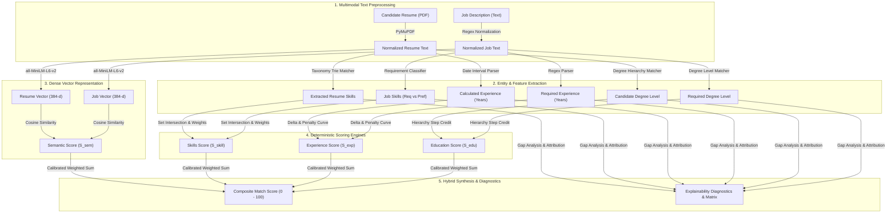

# AI & Machine Learning Architecture
## ResumeMatch: Hybrid Semantic & Deterministic Matching Engine

---

## 1. Architectural Philosophy: Why Hybrid Over Keyword or Pure LLM

Modern recruiting technology is hampered by two opposite extremes:
1. **Legacy ATS (Keyword Search)**: Relies on exact token string matching (e.g., TF-IDF, BM25). Fails fundamentally on synonyms ("Kubernetes" vs. "K8s", "GCP" vs. "Google Cloud"), polysemy, and context. Encourages candidate "keyword stuffing" while penalizing well-qualified candidates who phrase their accomplishments differently.
2. **Pure Generative LLMs (Black Box)**: Prompting large language models (e.g., GPT-4) to grade resumes produces non-deterministic scores, suffers from cognitive hallucinations, incurs 3,000–8,000 ms per-request latency, costs significant per-token API fees, and presents grave data privacy concerns by streaming sensitive candidate PII across the public internet.

### The ResumeMatch Hybrid Solution
ResumeMatch bridges these paradigms through an explainable, deterministic-guided neural architecture:
- **Dense Semantic Embeddings**: Captures conceptual alignment, technical domain proximity, and holistic contextual relevance.
- **Deterministic Skill Ontology**: Enforces strict verification of mission-critical requirements, distinguishing hard prerequisites from nice-to-haves.
- **Structural Experience & Education Matchers**: Accurately computes timeline deltas and educational hierarchy levels without fuzzy guesswork.
- **Rule-Based Explainability Engine**: Produces 100% reproducible, auditable explanations that break down every point in the final score.



---

## 2. Embedding Model Selection & Evaluation

### 2.1 Model Benchmark Comparison

| Model | Embedding Dimensions | Parameter Count | Model Size (Disk) | Average CPU Latency (512 tokens) | MTEB Semantic Similarity Score | Suitability for ResumeMatch |
| :--- | :--- | :--- | :--- | :--- | :--- | :--- |
| **`all-MiniLM-L6-v2`** (Selected) | **384** | **22.7M** | **~80 MB** | **~25 ms** | **68.06** | **Optimal**: High accuracy, minimal footprint, sub-30ms CPU inference. |
| `all-mpnet-base-v2` | 768 | 109M | ~420 MB | ~110 ms | 69.57 | High quality, but 4x memory footprint and slower CPU throughput. |
| `bge-small-en-v1.5` | 384 | 33.4M | ~130 MB | ~35 ms | 68.46 | Strong alternative; viable drop-in replacement. |
| OpenAI `text-embedding-3-small` | 1536 | Proprietary | Cloud | 180–400 ms (Network) | 71.00 | Rejected: External dependency, recurring costs, PII transmission risk. |

### 2.2 Model Architecture Details
- **Architecture**: 6-layer MiniLM transformer fine-tuned on >1 billion sentence pairs using contrastive learning.
- **Max Sequence Length**: 256–512 word pieces with sliding-window chunking and mean pooling over token embeddings to represent full resumes and job descriptions without truncation artifacts.
- **Inference Optimization**: PyTorch CPU inference with multi-threading and quantization compatibility.

---

## 3. Natural Language Processing & Entity Extraction Pipeline

### 3.1 Document Segmentation
Raw text extracted via PyMuPDF is partitioned into canonical sections using heading detection heuristics:
- `SUMMARY`: Professional summaries, objectives.
- `SKILLS`: Technical proficiencies, tools, platforms.
- `EXPERIENCE`: Chronological employment history.
- `EDUCATION`: Academic degrees, institutions, graduation dates.
- `PROJECTS`: Portfolio projects and open-source contributions.

### 3.2 Canonical Skill Taxonomy & Normalization
The system contains a curated, versioned taxonomy of over **1,200+ industry skills**, organized hierarchically:
- **Categories**: Languages, Frontend, Backend, Databases, Cloud & DevOps, AI/ML, Data Engineering, Testing, Architecture, Soft Skills.
- **Alias Resolution Engine**:
  ```json
  {
    "canonical": "PostgreSQL",
    "category": "Databases",
    "aliases": ["postgres", "postgresql", "pgsql", "postgres db"]
  }
  ```
- **Boundary-Guarded Extraction**: Uses regex word boundaries (`\b`) and token matching to prevent false positives (e.g., ensuring "c" does not match within "cloud" or "go" within "good").

### 3.3 Experience Timeline Parser
1. Locates work experience entries using regex patterns for dates:
   - `(Jan|Feb|...|December|\d{2})[-/ ]+(\d{4})\s*[-–to]+\s*(Present|Current|\d{4})`
2. Computes total elapsed months per role.
3. Performs interval merging to prevent double-counting overlapping concurrent jobs.
4. Converts months into net years: $\text{Years}_{\text{candidate}} = \sum \text{Intervals} / 12$.

### 3.4 Education Hierarchy Classifier
Maps extracted degree strings to an ordinal scale:
$$\text{Rank}(\text{Degree}) = \begin{cases} 
5 & \text{Doctorate / Ph.D. / Post-Doc} \\
4 & \text{Master's (M.S., M.A., M.B.A., M.Tech)} \\
3 & \text{Bachelor's (B.S., B.A., B.Tech, B.E.)} \\
2 & \text{Associate Degree} \\
1 & \text{High School / Secondary Diploma} \\
0 & \text{Unspecified / Not Detected}
\end{cases}$$

---

## 4. Mathematical Formulation of the Hybrid Scoring Engine

The overall compatibility score is bounded within $[0, 100]$:

$$S_{\text{composite}} = W_{\text{skill}} \cdot S_{\text{skills}} + W_{\text{sem}} \cdot S_{\text{semantic}} + W_{\text{exp}} \cdot S_{\text{exp}} + W_{\text{edu}} \cdot S_{\text{edu}}$$

### Calibrated Weight Distribution
| Component | Weight ($W_i$) | Rationale |
| :--- | :--- | :--- |
| **Deterministic Skills ($S_{\text{skills}}$)** | **0.40** | Direct qualification alignment; critical threshold for technical screening. |
| **Semantic Similarity ($S_{\text{semantic}}$)** | **0.35** | Holistic domain relevance, role context, and vocabulary alignment. |
| **Experience Fit ($S_{\text{exp}}$)** | **0.15** | Seniority verification with non-linear under-qualification penalty. |
| **Education Fit ($S_{\text{edu}}$)** | **0.10** | Academic baseline alignment with soft penalty for missing degrees. |

---

### Component Sub-Score Formulations

#### 1. Semantic Similarity ($S_{\text{semantic}}$)
Given dense unit vectors $\mathbf{v}_r = \text{Embed}(\text{Resume})$ and $\mathbf{v}_j = \text{Embed}(\text{Job})$:
$$\cos(\mathbf{v}_r, \mathbf{v}_j) = \frac{\mathbf{v}_r \cdot \mathbf{v}_j}{\|\mathbf{v}_r\| \|\mathbf{v}_j\|}$$
To eliminate negative cosine values and map natural semantic range $[0.2, 0.9]$ onto a normalized $[0, 100]$ curve:
$$S_{\text{semantic}} = \text{clamp}\left( \frac{\cos(\mathbf{v}_r, \mathbf{v}_j) - \tau_{\min}}{\tau_{\max} - \tau_{\min}}, 0, 1 \right) \times 100$$
*(Default calibration: $\tau_{\min} = 0.20$, $\tau_{\max} = 0.85$)*.

#### 2. Deterministic Skill Score ($S_{\text{skills}}$)
Skills extracted from the job description are partitioned into **Required** ($\mathcal{K}_{\text{req}}$) and **Preferred** ($\mathcal{K}_{\text{pref}}$). Let $\mathcal{K}_{\text{cand}}$ be the set of canonical skills extracted from the candidate's resume.

$$\text{Recall}_{\text{req}} = \frac{|\mathcal{K}_{\text{cand}} \cap \mathcal{K}_{\text{req}}|}{\max(1, |\mathcal{K}_{\text{req}}|)}, \quad \text{Recall}_{\text{pref}} = \frac{|\mathcal{K}_{\text{cand}} \cap \mathcal{K}_{\text{pref}}|}{\max(1, |\mathcal{K}_{\text{pref}}|)}$$

$$S_{\text{skills}} = \left( 0.75 \cdot \text{Recall}_{\text{req}} + 0.25 \cdot \text{Recall}_{\text{pref}} \right) \times 100$$
*(If the job description does not differentiate preferred skills, all identified skills are weighted in $\mathcal{K}_{\text{req}}$)*.

#### 3. Experience Score ($S_{\text{exp}}$)
Let $Y_c$ be candidate years and $Y_r$ be required years:
$$S_{\text{exp}} = \begin{cases}
100 & \text{if } Y_c \ge Y_r \\
\left( \frac{Y_c}{Y_r} \right)^{1.2} \times 100 & \text{if } 0 < Y_c < Y_r \\
40 & \text{if } Y_c = 0 \text{ and } Y_r \le 1 \\
10 & \text{if } Y_c = 0 \text{ and } Y_r > 1
\end{cases}$$
*(The exponent $1.2$ introduces a mild non-linear penalty for substantial experience gaps)*.

#### 4. Education Score ($S_{\text{edu}}$)
Let $R_c = \text{Rank}(\text{Degree}_{\text{cand}})$ and $R_r = \text{Rank}(\text{Degree}_{\text{req}})$:
$$S_{\text{edu}} = \begin{cases}
100 & \text{if } R_c \ge R_r \\
85 & \text{if } R_c = R_r - 1 \quad \text{(e.g., Bachelor's applying for Master's role)} \\
60 & \text{if } R_c = R_r - 2 \\
30 & \text{if } R_c < R_r - 2
\end{cases}$$

---

## 5. Explainability & Diagnostics Engine

Unlike opaque deep-learning models, every match output contains an explicit **Audit & Attribution Payload**:

```json
{
  "overall_score": 86.4,
  "sub_scores": {
    "semantic_score": 82.5,
    "skills_score": 90.0,
    "experience_score": 100.0,
    "education_score": 85.0
  },
  "weights": {
    "semantic": 0.35,
    "skills": 0.40,
    "experience": 0.15,
    "education": 0.10
  },
  "skills_analysis": {
    "matched_required": ["Python", "FastAPI", "PostgreSQL", "Docker"],
    "matched_preferred": ["Redis", "Kubernetes"],
    "missing_critical": ["AWS", "Terraform"],
    "missing_preferred": ["GraphQL"],
    "total_matched_count": 6,
    "total_required_count": 6,
    "total_preferred_count": 3
  },
  "experience_analysis": {
    "candidate_years": 6.2,
    "required_years": 5.0,
    "delta_years": 1.2,
    "status": "EXCEEDS_REQUIREMENT"
  },
  "education_analysis": {
    "candidate_degree": "Bachelor of Science in Computer Science",
    "required_degree": "Master of Science in Computer Science",
    "status": "PARTIALLY_ALIGNED"
  },
  "explanation_narrative": {
    "summary": "Strong candidate match (86.4%). Demonstrates solid core backend proficiency.",
    "strengths": [
      "Demonstrates 6.2 years of relevant experience, exceeding the 5.0-year requirement.",
      "Matches 100% of core required backend skills including Python, FastAPI, and PostgreSQL."
    ],
    "gaps": [
      "Candidate lacks demonstrated exposure to cloud infrastructure tools (AWS, Terraform).",
      "Position prefers a Master's degree, while candidate holds a Bachelor's degree."
    ],
    "recommendations": [
      "Highlight any personal or cloud deployment experience with AWS or alternative cloud providers.",
      "Emphasize scalable architectural achievements to offset the Master's credential preference."
    ]
  }
}
```

---

## 6. AI/ML Evaluation Strategy & Benchmark Suite

### 6.1 Gold-Standard Benchmark Dataset
The platform ships with a version-controlled benchmark dataset (`backend/app/evaluation/test_cases.json`) comprising:
- **30 Ground-Truth Pairs**: Diverse resumes spanning Senior, Mid, Junior, Career-Changer, and Mismatched profiles matched against standardized real-world tech job descriptions.
- **Human Consensus Ratings**: Each pair contains human expert consensus labels for:
  - Expected Score Range (e.g., $85 \pm 5$)
  - Expected Skill Intersection (True Positives, False Positives)
  - Fit Classification (`HIGH_FIT`, `MODERATE_FIT`, `LOW_FIT`, `REJECT`).

### 6.2 Quantitative Evaluation Metrics
The automated test runner computes:
1. **Skill Extraction Precision & Recall**:
   $$\text{Precision} = \frac{TP}{TP + FP}, \quad \text{Recall} = \frac{TP}{TP + FN}, \quad F_1 = 2 \cdot \frac{P \cdot R}{P + R}$$
   *Target: $F_1 \ge 0.88$ across benchmark taxonomy.*
2. **Ranking Correlation**:
   - Pearson ($r$) and Spearman ($\rho$) rank correlation between hybrid score and human expert rankings.
   - *Target: Spearman $\rho \ge 0.85$*.
3. **Inference Latency Budget**:
   - Total pipeline execution $\le 1,500$ ms on 4-core CPU.
