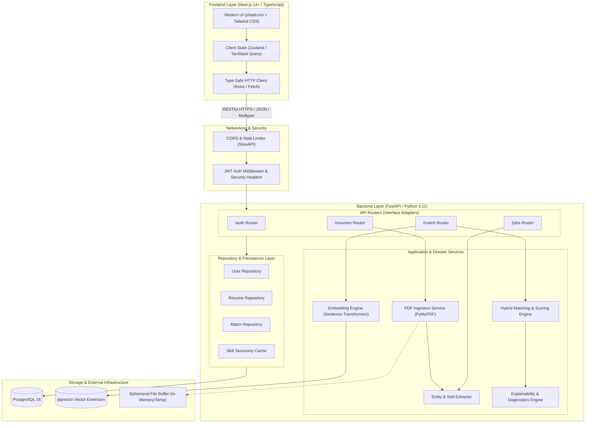
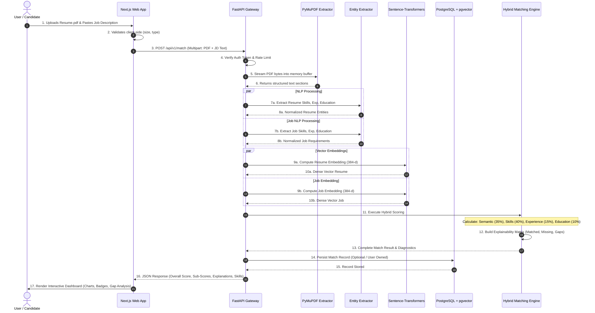

# System Architecture Document
## ResumeMatch: Technical Architecture & System Design

---

## 1. High-Level System Architecture

ResumeMatch is engineered following **Clean Architecture** principles, maintaining strict separation between presentation, application use cases, domain logic, and external infrastructure/drivers. The platform operates as a modern decoupled full-stack system consisting of a **Next.js (TypeScript)** frontend client and a high-performance **FastAPI (Python 3.11)** backend microservice backed by **PostgreSQL with the `pgvector` extension**.



---

## 2. Architectural Design Patterns & Principles

### 2.1 Clean / Hexagonal Architecture
The backend is structured into distinct concentric layers:
1. **Domain Layer**: Pure business entities, domain types, and pure algorithms (e.g., scoring equations, math functions, skill normalization taxonomy) with **zero external framework dependencies**.
2. **Application Layer (Use Cases)**: Coordinates workflow operations (e.g., `ProcessResumeUseCase`, `CalculateMatchUseCase`).
3. **Interface Adapters**: FastAPI routers, request/response Pydantic schemas, serializers, and presenters.
4. **Infrastructure Layer**: Concrete implementations of database persistence (SQLAlchemy 2.0 Async), ML model inference (HuggingFace/PyTorch), and file extraction (PyMuPDF).

### 2.2 Inversion of Control & Dependency Injection
- FastAPI's native `Depends` system is used to inject database sessions, configuration objects, authentication contexts, and service instances.
- Services depend on abstract interfaces (Protocols/ABC), facilitating seamless mocking in unit tests.

### 2.3 Statelessness & Horizontal Scalability
- Backend workers maintain zero persistent in-memory session state.
- Authentication utilizes stateless cryptographic JSON Web Tokens (JWT).
- The embedding model is loaded into memory as a singleton worker process at startup, avoiding re-initialization overhead per request.

---

## 3. Technology Stack Evaluation & Justification

| Layer | Technology | Version | Rationale & Tradeoffs |
| :--- | :--- | :--- | :--- |
| **Frontend Framework** | Next.js (App Router) | 14+ / 15 | Server-side rendering, optimized bundle splitting, built-in routing, and strong React 18+ ecosystem integration. |
| **Frontend Language** | TypeScript | 5.x | End-to-end type safety, eliminating runtime property mismatches and improving developer velocity. |
| **Styling & Components**| Tailwind CSS + shadcn/ui | Latest | Atomic CSS performance, accessibility-compliant primitive components (Radix UI based), fully customizable dark mode. |
| **Icons & Visualization**| Lucide React + Recharts | Latest | Lightweight vector iconography and responsive SVG charting for match score breakdowns and radar plots. |
| **Backend Framework** | FastAPI | 0.110+ | Asynchronous native Python web framework, automatic OpenAPI documentation, high RPS, built on Starlette and Pydantic. |
| **Runtime Environment** | Python | 3.11.x | Optimal performance improvements (PEP 659 adaptive interpreter), broad binary wheel compatibility for PyTorch/transformers. |
| **ORM / Data Access** | SQLAlchemy (Async) | 2.0+ | Modern type-annotated ORM, non-blocking async DB sessions via `asyncpg`, robust connection pooling. |
| **Database** | PostgreSQL | 16 | ACID-compliant relational storage for users, metadata, and structured matching results. |
| **Vector Storage** | `pgvector` | 0.7+ | Seamless integration directly inside PostgreSQL; eliminates the operational complexity and cost of external vector stores (Pinecone/Milvus). |
| **AI / Embeddings** | `sentence-transformers` | 2.5+ | Local inference with `all-MiniLM-L6-v2` (384-d). Fast CPU execution (<30ms), zero external API cost or latency, total data privacy. |
| **PDF Extraction** | PyMuPDF (`fitz`) | 1.23+ | 10x-50x faster than `pypdf` or `pdfminer`, superior font/layout extraction, rock-solid C-level parsing engine. |
| **Testing** | pytest, Playwright | Latest | Comprehensive test coverage across backend units, async integrations, and end-to-end browser journeys. |

---

## 4. End-to-End Processing Workflow



---

## 5. Recommended Repository & Directory Structure

```text
RsmeMatch/
├── .github/
│   └── workflows/
│       ├── backend-ci.yml           # Backend lint, typecheck, pytest
│       └── frontend-ci.yml          # Frontend lint, build, e2e test
├── docs/                            # Comprehensive architectural documentation
│   ├── PRODUCT_REQUIREMENTS.md
│   ├── ARCHITECTURE.md
│   ├── AI_ML_ARCHITECTURE.md
│   ├── DATABASE_DESIGN.md
│   ├── API_DESIGN.md
│   ├── SECURITY.md
│   ├── TESTING.md
│   └── ROADMAP.md
├── backend/
│   ├── app/
│   │   ├── __init__.py
│   │   ├── main.py                  # FastAPI application entrypoint & lifecycle
│   │   ├── core/                    # Core configs, security, logging
│   │   │   ├── __init__.py
│   │   │   ├── config.py            # Pydantic BaseSettings (env vars)
│   │   │   ├── security.py          # Password hashing, JWT creation/validation
│   │   │   └── logging.py           # Structured JSON logger configuration
│   │   ├── db/                      # Database engine & session management
│   │   │   ├── __init__.py
│   │   │   ├── session.py           # Async engine & session factory
│   │   │   └── base.py              # Declarative Base
│   │   ├── models/                  # SQLAlchemy ORM models
│   │   │   ├── __init__.py
│   │   │   ├── user.py
│   │   │   ├── resume.py
│   │   │   ├── job.py
│   │   │   └── match.py
│   │   ├── schemas/                 # Pydantic request/response schemas
│   │   │   ├── __init__.py
│   │   │   ├── user.py
│   │   │   ├── resume.py
│   │   │   ├── job.py
│   │   │   └── match.py
│   │   ├── api/                     # API routes & controllers
│   │   │   ├── __init__.py
│   │   │   ├── deps.py              # FastAPI dependency injection (auth, db)
│   │   │   └── v1/
│   │   │       ├── __init__.py
│   │   │       ├── router.py        # Central v1 APIRouter
│   │   │       ├── auth.py          # /auth endpoints
│   │   │       ├── resumes.py       # /resumes endpoints
│   │   │       ├── jobs.py          # /jobs endpoints
│   │   │       └── match.py         # /match endpoints
│   │   ├── services/                # Business logic & domain services
│   │   │   ├── __init__.py
│   │   │   ├── pdf_parser.py        # PyMuPDF extraction & sectioning
│   │   │   ├── nlp_extractor.py     # Skills, experience, education extraction
│   │   │   ├── embedding_service.py # Sentence-transformers embedding wrapper
│   │   │   ├── scoring_engine.py    # Deterministic + semantic hybrid scorer
│   │   │   └── explainability.py    # Natural language & gap diagnostic engine
│   │   ├── taxonomy/                # Curated skill & credential ontology
│   │   │   ├── __init__.py
│   │   │   ├── skills_taxonomy.json # Normalized skills, categories, aliases
│   │   │   └── degrees.json         # Educational hierarchy mapping
│   │   └── evaluation/              # AI/ML evaluation dataset & benchmark harness
│   │       ├── __init__.py
│   │       ├── benchmark.py         # Evaluation runner (precision, recall, correlation)
│   │       └── test_cases.json      # Gold-standard labeled resume-job pairs
│   ├── alembic/                     # Database migrations
│   │   ├── env.py
│   │   └── versions/
│   ├── tests/                       # Automated test suite
│   │   ├── __init__.py
│   │   ├── conftest.py              # Test fixtures (async client, mock db)
│   │   ├── test_pdf_parser.py
│   │   ├── test_nlp_extractor.py
│   │   ├── test_scoring_engine.py
│   │   ├── test_api_auth.py
│   │   ├── test_api_resumes.py
│   │   └── test_api_match.py
│   ├── alembic.ini
│   ├── requirements.txt
│   ├── requirements-dev.txt
│   └── Dockerfile
├── frontend/
│   ├── src/
│   │   ├── app/                     # Next.js App Router pages
│   │   │   ├── layout.tsx           # Global layout (providers, navbar, footer)
│   │   │   ├── page.tsx             # Landing / marketing page
│   │   │   ├── login/page.tsx       # Auth login
│   │   │   ├── register/page.tsx    # Auth registration
│   │   │   ├── dashboard/page.tsx   # Match dashboard & history
│   │   │   └── match/page.tsx       # Interactive Match Workspace
│   │   ├── components/              # Modular UI components
│   │   │   ├── ui/                  # shadcn/ui primitives (button, card, dialog, etc.)
│   │   │   ├── navbar.tsx           # Navigation bar with theme toggle
│   │   │   ├── file-upload.tsx      # Drag-and-drop resume upload zone
│   │   │   ├── job-input.tsx        # Structured job description textarea
│   │   │   ├── score-overview.tsx   # Circular & progress score indicators
│   │   │   ├── score-breakdown.tsx  # Radar / horizontal bar chart breakdown
│   │   │   ├── skill-matrix.tsx     # Matched vs. missing skill tags
│   │   │   └── match-explanation.tsx# Natural language diagnostic report
│   │   ├── lib/                     # Client utilities
│   │   │   ├── api.ts               # Axios / fetch client with interceptors
│   │   │   ├── auth.ts              # Token storage & auth helpers
│   │   │   └── utils.ts             # Tailwind class merging (cn)
│   │   ├── types/                   # TypeScript interfaces matching backend schemas
│   │   │   └── index.ts
│   │   └── styles/
│   │       └── globals.css          # Tailwind directives and CSS variables
│   ├── public/                      # Static assets & brand graphics
│   ├── tests/                       # Playwright E2E tests
│   │   ├── auth.spec.ts
│   │   └── match_flow.spec.ts
│   ├── package.json
│   ├── tsconfig.json
│   ├── tailwind.config.ts
│   ├── next.config.js
│   └── Dockerfile
├── docker-compose.yml               # Multi-container orchestration (App + PG + pgvector)
├── .env.example                     # Environment template
├── .gitignore
└── README.md
```

---

## 6. Cross-Cutting Architectural Concerns

### 6.1 Configuration & Environment Management
- Environment variables are managed centrally via Pydantic's `BaseSettings` (`backend/app/core/config.py`).
- Automatic type casting, validation, and rejection of startup if essential security keys (e.g., `SECRET_KEY`, `DATABASE_URL`) are omitted or default in production.

### 6.2 Structured Logging & Observability
- All backend events output structured JSON logs with correlation IDs (`request_id`), timestamps, latency measurements, and log levels.
- PII (emails, names, phone numbers) is strictly sanitized from logs.

### 6.3 Resilient Error Handling
- Custom global FastAPI exception handlers intercept:
  - `RequestValidationError`: Formats 422 errors into friendly UI messages.
  - `HTTPException`: Standardizes JSON envelope across all status codes.
  - `PDFParsingError`: Catches corrupted or password-protected files gracefully.
  - Unhandled 500 exceptions: Logs full traceback internally while serving a sanitized, non-leaking message to the client.
