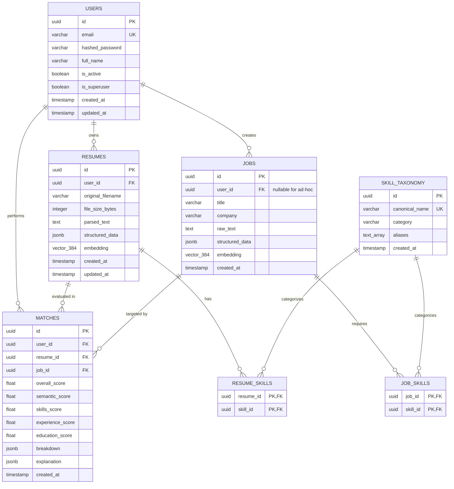

# Database Architecture & Design Document
## ResumeMatch: PostgreSQL & pgvector Schema Specification

---

## 1. Architectural Overview & Storage Engine

ResumeMatch utilizes **PostgreSQL 16** as its unified primary datastore, leveraging the **`pgvector`** extension to natively integrate dense vector search alongside ACID-compliant relational data.

### Why Unified PostgreSQL + pgvector?
1. **Single Source of Truth**: Eliminates dual-write consistency hazards, network synchronization overhead, and split-brain failures that occur when pairing a traditional SQL DB with external vector databases (e.g., Pinecone, Weaviate).
2. **Transactional Integrity & Cascade Cleanup**: Crucial for privacy compliance. When a user requests hard deletion of their resume, a single SQL `DELETE` cascades across all structured records, JSONB metadata, and high-dimensional vectors atomically.
3. **Hybrid Querying**: Supports simultaneous relational filtering (e.g., `WHERE user_id = :uid`) and vector distance sorting (`ORDER BY embedding <=> :query_vec`) in a single query planner pass.

---

## 2. Entity-Relationship Diagram (ERD)



---

## 3. Schema DDL & Table Specifications

### 3.1 Extension Initialization
```sql
CREATE EXTENSION IF NOT EXISTS "uuid-ossp";
CREATE EXTENSION IF NOT EXISTS "vector";
```

### 3.2 Table Definitions

#### `users`
Manages authenticated identity, role-based authorization, and user preferences.
```sql
CREATE TABLE users (
    id UUID PRIMARY KEY DEFAULT uuid_generate_v4(),
    email VARCHAR(255) NOT NULL UNIQUE,
    hashed_password VARCHAR(255) NOT NULL,
    full_name VARCHAR(255),
    is_active BOOLEAN NOT NULL DEFAULT TRUE,
    is_superuser BOOLEAN NOT NULL DEFAULT FALSE,
    created_at TIMESTAMPTZ NOT NULL DEFAULT CURRENT_TIMESTAMP,
    updated_at TIMESTAMPTZ NOT NULL DEFAULT CURRENT_TIMESTAMP
);

CREATE INDEX idx_users_email ON users(email);
```

#### `resumes`
Stores candidate resumes, parsed text sections, normalized entity JSON, and dense 384-dimensional vector embeddings.
```sql
CREATE TABLE resumes (
    id UUID PRIMARY KEY DEFAULT uuid_generate_v4(),
    user_id UUID NOT NULL REFERENCES users(id) ON DELETE CASCADE,
    original_filename VARCHAR(255) NOT NULL,
    file_size_bytes INTEGER NOT NULL,
    parsed_text TEXT NOT NULL,
    structured_data JSONB NOT NULL DEFAULT '{}'::jsonb,
    embedding vector(384),
    created_at TIMESTAMPTZ NOT NULL DEFAULT CURRENT_TIMESTAMP,
    updated_at TIMESTAMPTZ NOT NULL DEFAULT CURRENT_TIMESTAMP
);

CREATE INDEX idx_resumes_user_id ON resumes(user_id);
CREATE INDEX idx_resumes_created_at ON resumes(created_at DESC);
CREATE INDEX idx_resumes_structured_gin ON resumes USING gin (structured_data);
```

#### `jobs`
Stores job postings, required credentials, structured skill expectations, and target embeddings. Supports both saved recruiter jobs and on-the-fly ad-hoc job submissions.
- **Ad-hoc / Inline Job Ingestion Mapping**: Per AGENTS.md Rule 4, all inline job descriptions submitted on-the-fly for matching are persisted directly to a `Job` record. In this scenario, `user_id` may be null or set to the evaluating user, allowing immediate vector embedding and relational link to the resulting `Match` record.
```sql
CREATE TABLE jobs (
    id UUID PRIMARY KEY DEFAULT uuid_generate_v4(),
    user_id UUID REFERENCES users(id) ON DELETE SET NULL,
    title VARCHAR(255) NOT NULL,
    company VARCHAR(255),
    raw_text TEXT NOT NULL,
    structured_data JSONB NOT NULL DEFAULT '{}'::jsonb,
    embedding vector(384),
    created_at TIMESTAMPTZ NOT NULL DEFAULT CURRENT_TIMESTAMP
);

CREATE INDEX idx_jobs_user_id ON jobs(user_id);
CREATE INDEX idx_jobs_title ON jobs(title);
CREATE INDEX idx_jobs_structured_gin ON jobs USING gin (structured_data);
```

#### `matches`
Stores historic evaluation runs, composite compatibility scores, sub-score breakdowns, and explainability audit logs.
```sql
CREATE TABLE matches (
    id UUID PRIMARY KEY DEFAULT uuid_generate_v4(),
    user_id UUID NOT NULL REFERENCES users(id) ON DELETE CASCADE,
    resume_id UUID NOT NULL REFERENCES resumes(id) ON DELETE CASCADE,
    job_id UUID NOT NULL REFERENCES jobs(id) ON DELETE CASCADE,
    overall_score DOUBLE PRECISION NOT NULL,
    semantic_score DOUBLE PRECISION NOT NULL,
    skills_score DOUBLE PRECISION NOT NULL,
    experience_score DOUBLE PRECISION NOT NULL,
    education_score DOUBLE PRECISION NOT NULL,
    breakdown JSONB NOT NULL DEFAULT '{}'::jsonb,
    explanation JSONB NOT NULL DEFAULT '{}'::jsonb,
    created_at TIMESTAMPTZ NOT NULL DEFAULT CURRENT_TIMESTAMP
);

CREATE INDEX idx_matches_user_id ON matches(user_id);
CREATE INDEX idx_matches_resume_id ON matches(resume_id);
CREATE INDEX idx_matches_job_id ON matches(job_id);
CREATE INDEX idx_matches_created_at ON matches(created_at DESC);
```

#### `skill_taxonomy`
Houses canonical skills, technical domains, and comprehensive synonym/alias mappings.
```sql
CREATE TABLE skill_taxonomy (
    id UUID PRIMARY KEY DEFAULT uuid_generate_v4(),
    canonical_name VARCHAR(150) NOT NULL UNIQUE,
    category VARCHAR(100) NOT NULL,
    aliases TEXT[] NOT NULL DEFAULT '{}',
    created_at TIMESTAMPTZ NOT NULL DEFAULT CURRENT_TIMESTAMP
);

CREATE INDEX idx_skill_taxonomy_category ON skill_taxonomy(category);
CREATE INDEX idx_skill_taxonomy_aliases ON skill_taxonomy USING gin (aliases);
```

#### `resume_skills` (Association Table)
Enforces normalized many-to-many relationships between resumes and canonical skills in `skill_taxonomy`.
- Uses a composite primary key `(resume_id, skill_id)` to disallow duplicate skill associations.
- Cascades on delete from both `resumes` and `skill_taxonomy`.
```sql
CREATE TABLE resume_skills (
    resume_id UUID NOT NULL REFERENCES resumes(id) ON DELETE CASCADE,
    skill_id UUID NOT NULL REFERENCES skill_taxonomy(id) ON DELETE CASCADE,
    PRIMARY KEY (resume_id, skill_id)
);
```

#### `job_skills` (Association Table)
Enforces normalized many-to-many relationships between jobs and canonical skills in `skill_taxonomy`.
- Uses a composite primary key `(job_id, skill_id)` to disallow duplicate skill associations.
- Cascades on delete from both `jobs` and `skill_taxonomy`.
```sql
CREATE TABLE job_skills (
    job_id UUID NOT NULL REFERENCES jobs(id) ON DELETE CASCADE,
    skill_id UUID NOT NULL REFERENCES skill_taxonomy(id) ON DELETE CASCADE,
    PRIMARY KEY (job_id, skill_id)
);
```

---

## 4. Vector Indexing Strategy: HNSW vs. IVFFlat

For high-dimensional embeddings (384 dimensions), selecting the appropriate vector index is critical for balancing query latency, recall accuracy, and memory consumption.

| Parameter | HNSW (`vector_cosine_ops`) | IVFFlat (`vector_cosine_ops`) | ResumeMatch Decision |
| :--- | :--- | :--- | :--- |
| **Index Construction** | Graph-based multi-layer network | Inverted file list (clustering centroids) | **HNSW Selected** |
| **Recall Quality** | $\ge 98\%$ recall without retraining | 80–90% (degrades as data distribution shifts) | **HNSW**: Maximizes matching fidelity |
| **Build Time** | Moderate | Fast | Acceptable for portfolio scale |
| **Maintenance** | No clustering retraining required | Requires `REINDEX` after dataset growth | **HNSW**: Zero-maintenance operational profile |
| **Query Latency** | Sub-5ms at 50,000 vectors | 15–30ms depending on `probes` | **HNSW**: High throughput |

### HNSW Index Implementation
```sql
CREATE INDEX idx_resumes_embedding_hnsw 
ON resumes 
USING hnsw (embedding vector_cosine_ops)
WITH (m = 16, ef_construction = 64);

CREATE INDEX idx_jobs_embedding_hnsw 
ON jobs 
USING hnsw (embedding vector_cosine_ops)
WITH (m = 16, ef_construction = 64);
```

---

## 5. SQLAlchemy 2.0 Async ORM Mapping Design

```python
# backend/app/models/resume.py
from datetime import datetime
import uuid
from typing import Optional, Dict, Any
from sqlalchemy import String, Integer, Text, ForeignKey, DateTime
from sqlalchemy.dialects.postgresql import UUID, JSONB
from sqlalchemy.orm import Mapped, mapped_column, relationship
from pgvector.sqlalchemy import Vector
from app.db.base import Base

class Resume(Base):
    __tablename__ = "resumes"

    id: Mapped[uuid.UUID] = mapped_column(UUID(as_uuid=True), primary_key=True, default=uuid.uuid4)
    user_id: Mapped[uuid.UUID] = mapped_column(UUID(as_uuid=True), ForeignKey("users.id", ondelete="CASCADE"), nullable=False, index=True)
    original_filename: Mapped[str] = mapped_column(String(255), nullable=False)
    file_size_bytes: Mapped[int] = mapped_column(Integer, nullable=False)
    parsed_text: Mapped[str] = mapped_column(Text, nullable=False)
    structured_data: Mapped[Dict[str, Any]] = mapped_column(JSONB, default=dict)
    embedding: Mapped[Optional[list[float]]] = mapped_column(Vector(384), nullable=True)
    created_at: Mapped[datetime] = mapped_column(DateTime(timezone=True), default=datetime.utcnow)
    updated_at: Mapped[datetime] = mapped_column(DateTime(timezone=True), default=datetime.utcnow, onupdate=datetime.utcnow)

    user: Mapped["User"] = relationship("User", back_populates="resumes")
    matches: Mapped[list["Match"]] = relationship("Match", back_populates="resume", cascade="all, delete-orphan")
```

---

## 6. Migration Strategy & Database Lifecycle

1. **Alembic Versioning**:
   - Every database change is captured in deterministic, forward-and-backward migration scripts under `backend/alembic/versions/`.
   - Initial migration `0001_initial_schema.py` encapsulates extension creation, core tables, foreign key constraints, and HNSW indexes.
2. **Local Zero-Dependency Fallback**:
   - For rapid unit testing and environments where Docker/pgvector is not immediately spun up, the repository abstraction layer provides:
     - In-memory SQLite with NumPy cosine similarity fallback for isolated unit testing.
     - Production runs against PostgreSQL 16 + pgvector container defined in `docker-compose.yml`.
3. **Hard Deletion Compliance**:
   - Calling `DELETE FROM resumes WHERE id = :id` immediately removes physical text, embeddings, and cascades through `matches` records, guaranteeing full data sovereignty.
