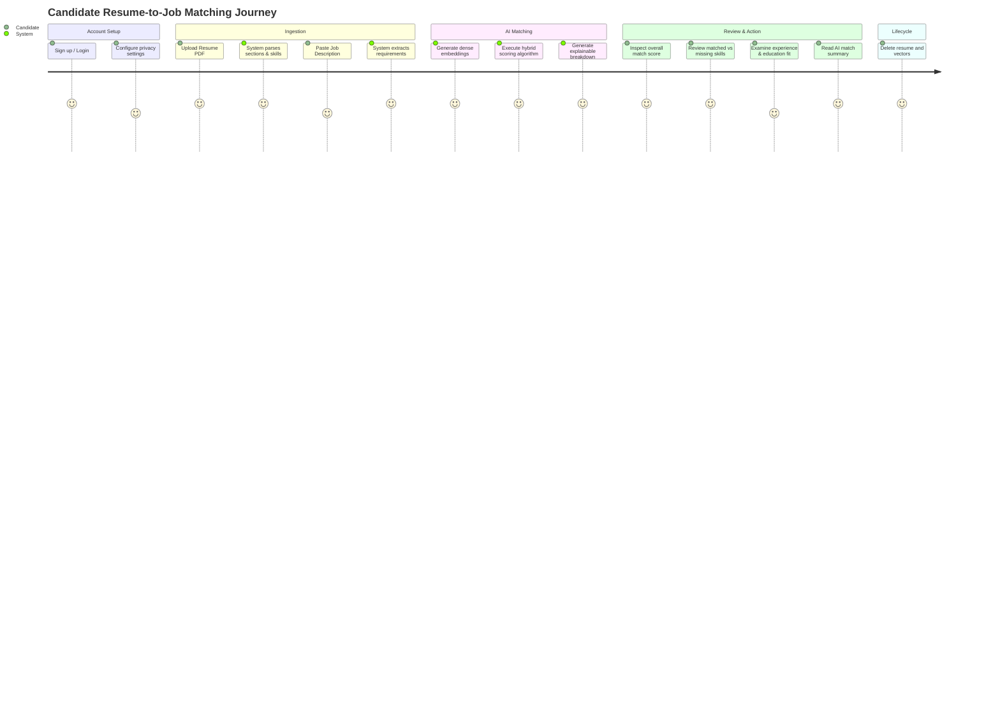

# Product Requirements Document (PRD)
## ResumeMatch: Explainable AI-Powered Resume-to-Job Matching Platform

---

## 1. Executive Summary & Product Vision

### 1.1 Product Vision
**ResumeMatch** is a production-grade, explainable AI platform designed to bridge the gap between job seekers' credentials and job market requirements. Unlike legacy Applicant Tracking Systems (ATS) that rely on primitive keyword counting or opaque "black-box" LLM evaluations, ResumeMatch delivers a **hybrid, multi-dimensional, and fully auditable matching engine**. 

The platform pairs dense semantic embeddings with deterministic skill ontology matching, experience timeline verification, and education alignment to generate a nuanced compatibility score alongside transparent, natural-language explanations.

### 1.2 Target Audience & User Personas
1. **The Modern Candidate (Alex - Senior Software Engineer)**
   - *Needs*: Wants to understand how well their resume aligns with specific target roles, identify missing domain-specific technical skills, and receive actionable insights to tailor their resume without guesswork.
   - *Pain Points*: Frustrated by ATS "black hole" rejections with zero feedback; concerned about data privacy and retention of their personal career history.
2. **The Recruiter / Technical Screener (Sarah - Talent Acquisition Partner)**
   - *Needs*: Needs objective, explainable, and calibrated scoring to shortlist resumes without bias or hallucinated qualifications.
   - *Pain Points*: Keyword search misses synonyms (e.g., "PostgreSQL" vs. "RDBMS", "K8s" vs. "Kubernetes"), while generative LLM screenings are slow, expensive, and inconsistent.
3. **The Engineering Interviewer / Hiring Manager**
   - *Needs*: Clear, auditable evidence of why a candidate was ranked high or low, with a direct mapping of required vs. demonstrated competencies.

### 1.3 Key Value Propositions
- **Semantic Understanding**: Recognizes conceptual relationships and synonyms beyond raw token overlap.
- **Explainability First**: Every score is deconstructed into deterministic sub-scores (Skills, Experience, Education, Semantic Fit) with explicit missing skill gaps and positive match highlights.
- **Privacy by Design**: Complete user control over career data, featuring single-click hard deletion of resumes, extracted entities, and vector embeddings.
- **Enterprise-Grade Engineering**: High-throughput FastAPI backend, pgvector persistence, resilient Next.js frontend, and comprehensive automated test coverage.

---

## 2. Functional Requirements (FR)

### Module 1: User Identity & Account Management
- **FR-1.1: Registration & Authentication**: Users must be able to sign up and authenticate using secure email/password credentials with bcrypt hashing and JWT session tokens.
- **FR-1.2: Profile & Privacy Preferences**: Users can toggle privacy settings, manage active sessions, and review their data retention status.
- **FR-1.3: Data Erasure (Right to Be Forgotten)**: Users can permanently purge their account, including all uploaded resumes, generated embeddings, and evaluation history.

### Module 2: Resume Ingestion & Parsing
- **FR-2.1: PDF File Ingestion**: Accepts PDF files up to 5 MB with strict MIME-type and magic-byte validation (`%PDF-`).
- **FR-2.2: Text & Section Extraction**: Employs PyMuPDF (`fitz`) to extract raw text with structural layout heuristics, segmenting content into:
  - Header / Contact Information
  - Professional Summary
  - Technical & Soft Skills
  - Professional Work Experience (Roles, Companies, Dates, Responsibilities)
  - Education (Institutions, Degrees, Fields, Graduation Dates)
  - Certifications & Projects
- **FR-2.3: Parsing Error Resilience**: If a PDF is image-only (scanned) or malformed, the system returns clear, actionable error diagnostics rather than failing silently.

### Module 3: Job Description (JD) Ingestion
- **FR-3.1: Freeform Text Ingestion**: Allows users to paste full job descriptions (up to 20,000 characters) or structured inputs (Title, Company, Seniority).
- **FR-3.2: Requirement Decomposition**: Segments job descriptions into:
  - Role overview and seniority level
  - Required (must-have) technical and domain skills
  - Preferred (nice-to-have) skills and qualifications
  - Minimum years of experience required
  - Minimum education degree required

### Module 4: Entity Extraction & Normalization
- **FR-4.1: Canonical Skill Taxonomy**: Maps raw keywords, abbreviations, and synonyms to a standardized skill ontology (e.g., `["k8s", "kube", "kubernetes"] -> "Kubernetes"`, `["postgres", "postgresql", "pgsql"] -> "PostgreSQL"`).
- **FR-4.2: Experience Calculation**: Extracts timeline intervals from resume work history to calculate cumulative relevant years of professional experience.
- **FR-4.3: Education Level Hierarchy**: Normalizes education credentials to a ranked tier:
  `High School (1) < Associate (2) < Bachelor's (3) < Master's (4) < Doctorate/PhD (5)`.

### Module 5: Semantic Embedding Generation
- **FR-5.1: Dense Vector Representation**: Generates 384-dimensional dense semantic vectors using a local, lightweight transformer model (`sentence-transformers/all-MiniLM-L6-v2`).
- **FR-5.2: Multi-Granularity Embeddings**: Computes embeddings for:
  - Full resume vs. full job description
  - Candidate technical profile vs. required job qualifications
- **FR-5.3: In-Memory / Vector DB Cache**: Persists vectors in PostgreSQL using `pgvector` to avoid redundant neural network re-computations.

### Module 6: Hybrid Scoring & Matching Engine
- **FR-6.1: Vector Semantic Similarity**: Computes cosine similarity between resume and JD vector representations.
- **FR-6.2: Deterministic Skill Matcher**: Calculates intersection of candidate skills with required and preferred job skills, applying weighted importance.
- **FR-6.3: Experience Delta Scoring**: Evaluates candidate experience years against the JD minimum, applying appropriate scaling and penalty curves.
- **FR-6.4: Education Alignment Scoring**: Evaluates degree level match against job prerequisites.
- **FR-6.5: Composite Hybrid Score**: Generates a calibrated composite score $S \in [0, 100]$ using a transparent, weighted formula.

### Module 7: Explainability & Insights Engine
- **FR-7.1: Skill Gap Identification**: Explicitly categorizes skills into:
  - **Matched Essential Skills** (e.g., Python, Docker)
  - **Matched Preferred Skills** (e.g., Redis, AWS)
  - **Missing Critical Skills** (e.g., Kubernetes, GraphQL)
  - **Missing Secondary Skills** (e.g., CI/CD)
- **FR-7.2: Experience & Education Assessment**: Displays comparative metrics (e.g., "5 years demonstrated vs. 3 years required", "Bachelor's meets requirement").
- **FR-7.3: Natural Language Summary**: Synthesizes a factual, template-driven natural language narrative highlighting candidate strengths and actionable areas for improvement.
- **FR-7.4: Visual Score Breakdown**: Provides data structures for frontend visualization (Radar charts, score breakdown cards, skill badge matrices).

### Module 8: Data Privacy & Safe Deletion
- **FR-8.1: Safe File Purge**: Immediate or on-demand unlinking and deletion of physical/temporary PDF files from storage.
- **FR-8.2: Granular Entity Deletion**: Endpoint to delete a specific resume, which cascades to delete all associated parsed texts, embeddings, and match records.
- **FR-8.3: No External Leakage**: Entire AI pipeline executes locally on-premise without sending candidate resumes to third-party proprietary LLM APIs.

---

## 3. Non-Functional Requirements (NFR)

### 3.1 Performance & Latency
- **NFR-1.1**: PDF text extraction and parsing must complete within **800 ms** for documents up to 5 pages.
- **NFR-1.2**: Neural embedding generation and vector similarity computation must complete within **500 ms** on standard CPU.
- **NFR-1.3**: End-to-end match analysis (upload -> parse -> embed -> score -> explain) must respond in under **2.5 seconds**.
- **NFR-1.4**: Static assets and frontend pages must achieve sub-second Time-to-First-Byte (TTFB) and a Lighthouse Performance score $\ge 90$.

### 3.2 Scalability & Concurrency
- **NFR-2.1**: Stateless FastAPI architecture allowing horizontal scaling behind a reverse proxy.
- **NFR-2.2**: Asynchronous non-blocking database queries via SQLAlchemy 2.0 async engine and connection pooling.
- **NFR-2.3**: Optimized vector indexing using `pgvector` HNSW indexes for sub-50ms neighbor search across tens of thousands of records.

### 3.3 Security & Compliance
- **NFR-3.1**: Robust input validation via Pydantic v2 schemas; sanitization of all user-supplied text inputs against XSS and injection.
- **NFR-3.2**: Defense against malicious PDF uploads (ZIP bombs, embedded script exploits, excessive resource consumption) using memory limits and timeout guards.
- **NFR-3.3**: Zero persistent storage of unencrypted sensitive credentials; password hashing using bcrypt (salt rounds $\ge 12$).
- **NFR-3.4**: Strict CORS policy, HTTP-only secure cookies, and security headers (CSP, HSTS, X-Frame-Options).

### 3.4 Usability & Accessibility
- **NFR-4.1**: Full compliance with WCAG 2.1 Level AA accessibility standards (contrast ratios, ARIA tags, keyboard navigability).
- **NFR-4.2**: Responsive, mobile-first design rendering seamlessly across mobile (375px), tablet (768px), and desktop (1280px+).
- **NFR-4.3**: Intuitive drag-and-drop file upload zone with clear progress indicators and instant validation feedback.

### 3.5 Maintainability & Code Quality
- **NFR-5.1**: Strict type checking across TypeScript (strict mode) and Python (type annotations validated by mypy/Pydantic).
- **NFR-5.2**: Test coverage target: $\ge 85\%$ across backend business logic, parsers, scoring algorithms, and API routers.
- **NFR-5.3**: Deterministic, reproducible builds with pinned dependencies and Docker containerization.

---

## 4. User Journey Map

---

## 5. Success Metrics & Key Performance Indicators (KPIs)

| Metric | Target | Measurement Method |
| :--- | :--- | :--- |
| **Parsing Success Rate** | $\ge 98\%$ of standard text PDFs | Automated test suite on diverse resume formats |
| **Skill Extraction Precision** | $\ge 90\%$ | Benchmark against labeled ground-truth dataset |
| **Scoring Explainability Completeness** | $100\%$ of scores have sub-score breakdown | Automated integration assertions |
| **End-to-End Processing Time** | $\le 2.5\text{ s}$ (CPU inference) | APM logging / Locust latency profiling |
| **Test Suite Coverage** | $\ge 85\%$ | pytest-cov & Playwright reports |
| **Accessibility Compliance** | $0$ WCAG 2.1 AA violations | axe-core automated audit |
