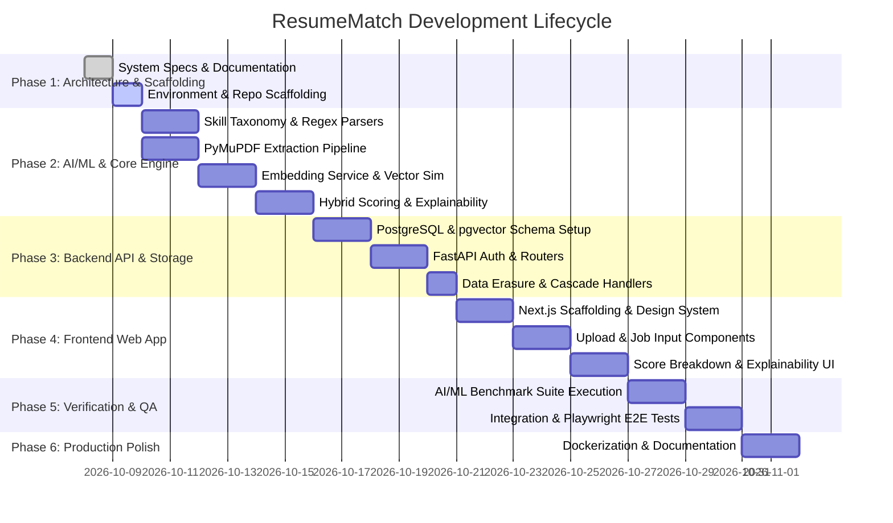

# Development Roadmap & Implementation Plan
## ResumeMatch: Phased Execution, Milestone Tracking & Risk Matrix

---

## 1. Phased Development Roadmap

---

## 2. Granular Phase Breakdown

### Phase 1: Planning, Environment & Scaffolding (Current)
- [x] Inspect local host environment (Python 3.11, Node.js 24, Git detected).
- [x] Author comprehensive architectural specifications:
  - `docs/PRODUCT_REQUIREMENTS.md`
  - `docs/ARCHITECTURE.md`
  - `docs/AI_ML_ARCHITECTURE.md`
  - `docs/DATABASE_DESIGN.md`
  - `docs/API_DESIGN.md`
  - `docs/SECURITY.md`
  - `docs/TESTING.md`
  - `docs/ROADMAP.md`
- [ ] Initialize Python 3.11 virtual environment (`backend/venv`).
- [ ] Initialize Next.js 14+ TypeScript project (`frontend`).
- [ ] Establish Git version control and initial repository structure.

### Phase 2: Core AI/ML Engine & PDF Extraction
- [ ] Implement `skills_taxonomy.json` containing 1,200+ canonical technical skills and alias mappings.
- [ ] Implement `backend/app/services/pdf_parser.py` using PyMuPDF (`fitz`) with section boundary detection.
- [ ] Implement `backend/app/services/nlp_extractor.py` for skill extraction, date interval calculation, and degree hierarchy mapping.
- [ ] Implement `backend/app/services/embedding_service.py` wrapping `sentence-transformers/all-MiniLM-L6-v2`.
- [ ] Implement `backend/app/services/scoring_engine.py` with calibrated hybrid weights and mathematical clamping.
- [ ] Implement `backend/app/services/explainability.py` generating structured attribution and factual narrative summaries.
- [ ] Author unit tests in `backend/tests/` to validate extraction accuracy, math invariants, and performance.

### Phase 3: Backend API, Persistence & Security
- [ ] Configure PostgreSQL with `pgvector` models (`User`, `Resume`, `Job`, `Match`).
- [ ] Create Alembic migration scripts (`0001_initial_schema.py`).
- [ ] Implement JWT authentication system with bcrypt password hashing (`backend/app/core/security.py`).
- [ ] Build FastAPI routers:
  - `/api/v1/auth` (Register, Login, Me)
  - `/api/v1/resumes` (Upload, Get, Delete)
  - `/api/v1/jobs` (Analyze, List)
  - `/api/v1/match` (Execute Match, Match History, Diagnostics)
- [ ] Implement rate limiting (SlowAPI) and global exception handlers.
- [ ] Verify safe cascading hard-deletion endpoint.

### Phase 4: Modern Next.js Frontend Application
- [ ] Scaffold Next.js TypeScript application with Tailwind CSS and shadcn/ui.
- [ ] Implement design system (clean typography, modern dark mode, glassmorphism card surfaces).
- [ ] Build drag-and-drop resume upload zone with client-side file validation and animated progress indicators.
- [ ] Build job description input pane with sample presets for quick demonstration.
- [ ] Build interactive Match Results Dashboard:
  - Overall Compatibility Score Gauge (circular animated percentage).
  - Multi-dimensional Sub-Score Breakdown (Skills, Semantic, Experience, Education).
  - Interactive Skill Matrix (Matched Required, Matched Preferred, Missing Critical Badges).
  - Natural Language Explainability Card with actionable improvement suggestions.
- [ ] Connect frontend to FastAPI backend using typed API client.

### Phase 5: Verification, Benchmarking & Testing
- [ ] Construct gold-standard benchmark dataset (`backend/app/evaluation/test_cases.json`) with 30 annotated cases.
- [ ] Build automated benchmark runner (`benchmark.py`) asserting $\text{Precision} \ge 0.90$ and Spearman $\rho \ge 0.85$.
- [ ] Write integration test suite with `pytest` and `httpx.AsyncClient` achieving $\ge 85\%$ coverage.
- [ ] Write Playwright E2E browser test suite covering full user journey, responsive design, and accessibility.

### Phase 6: Production Hardening, Docker & Portfolio Presentation
- [ ] Author multi-stage `Dockerfile` for backend and frontend.
- [ ] Create `docker-compose.yml` orchestrating FastAPI, Next.js, and PostgreSQL with `pgvector`.
- [ ] Author comprehensive `README.md` with architectural diagrams, demo screenshots, API reference, and quickstart instructions.
- [ ] Create clean, atomic Git commits demonstrating disciplined engineering practices.

---

## 3. Risks & Technical Mitigation Strategies

| Risk / Challenge | Severity | Likelihood | Mitigation Strategy |
| :--- | :--- | :--- | :--- |
| **Python 3.14 Compatibility** | High | High | Host system has Python 3.14 default, which lacks binary wheels for PyTorch and C extensions. **Mitigation**: Strictly target the installed **Python 3.11.9** (`py -3.11`) runtime for virtual environment creation. |
| **Docker Daemon Absence on Local Host** | Medium | High | Docker service is not running on the host machine. **Mitigation**: Design the backend with a dual persistence mode: full PostgreSQL/pgvector for containerized runs, plus an in-memory SQLite + NumPy vector similarity fallback for local zero-dependency testing. |
| **Sentence-Transformers Cold Start Latency** | Medium | Medium | Loading the neural model per request causes unacceptable 2-second spikes. **Mitigation**: Preload the model into memory as a singleton during FastAPI application startup (`lifespan` handler). |
| **PDF Format Heterogeneity** | High | High | Resumes use diverse multi-column, table-based, and non-standard layouts. **Mitigation**: PyMuPDF block-level sorting, layout-aware text extraction, and robust fallback heuristics for unstructured text blocks. |
| **False-Positive Skill Matches** | High | Medium | Short programming language names (e.g., "C", "R", "Go") triggering inside regular words. **Mitigation**: Strict word boundary regex guards (`\b`), n-gram matching, case-sensitive overrides for ambiguous single-letter tokens, and category context checking. |
| **Candidate PII Exposure** | Critical | Low | Accidental logging or leak of personal information. **Mitigation**: In-memory regex scrubbing of phone numbers and physical addresses; zero third-party cloud LLM API calls; one-click cascading hard delete. |

---

## 4. Architectural Self-Consistency Audit

Prior to implementation, the architecture was reviewed against all project requirements:
1. **Explainability vs. Neural Embeddings**: The design avoids pure black-box vector distance by maintaining separate, deterministic sub-scores for skills, experience, and education alongside natural language diagnostics.
2. **Type Safety & Contracts**: Shared contracts between Pydantic schemas on the backend and TypeScript interfaces on the frontend prevent serialization drift.
3. **Data Lifecycle & Privacy**: Immediate hard deletion (`ON DELETE CASCADE`) ensures compliance with GDPR without orphan records.
4. **Environment Isolation**: Python 3.11 virtual environment isolates dependencies cleanly from host Python 3.14.
