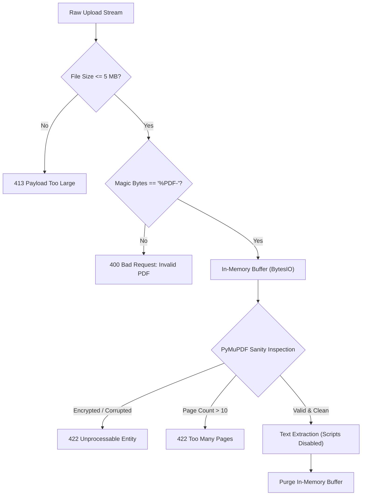

# Security Architecture & Threat Mitigation
## ResumeMatch: Security, Data Privacy & Defense-in-Depth Specification

---

## 1. Threat Modeling (STRIDE Framework)

| STRIDE Category | Threat Description | Attack Vector | ResumeMatch Mitigation Strategy |
| :--- | :--- | :--- | :--- |
| **Spoofing** | Attacker impersonates a legitimate candidate or recruiter. | Stolen tokens, brute-force password guessing. | Bcrypt hashing ($\ge 12$ rounds), cryptographically signed JWTs, rate-limiting on `/auth/login` (5 req/min). |
| **Tampering** | Attacker alters resume contents or match scoring parameters. | Parameter tampering, SQL injection. | SQLAlchemy parameterized queries, immutable match audit records, Pydantic strict schema validation. |
| **Repudiation** | User denies uploading a resume or requesting an evaluation. | Lack of audit logs. | Structured JSON security logging with correlation IDs (`request_id`), user UUID timestamps. |
| **Information Disclosure** | Candidate PII or resume details leaked to unauthorized users. | Insecure Direct Object References (IDOR), API data leaks. | Row-Level Access Control (`WHERE user_id = :uid`), local embedding inference with zero external cloud transmission. |
| **Denial of Service (DoS)**| Resource exhaustion via massive PDFs or embedding requests. | Decompression bombs, oversized PDFs, CPU-heavy embedding floods. | 5 MB upload ceiling, PyMuPDF page limit guards ($\le 10$ pages), SlowAPI rate limiting, async workers. |
| **Elevation of Privilege**| Standard candidate user executes admin or cross-user operations. | Forged JWT claims, path manipulation. | Role-Based Access Control (`is_superuser`), strict JWT subject validation on every protected route. |

---

## 2. File Ingestion & PDF Sandboxing

Allowing arbitrary file uploads presents significant attack surfaces (malicious PDF exploits, embedded JavaScript, nested stream decompression bombs).



### Defense Protocols:
1. **Magic Byte Verification**: Confirms file begins with `%PDF-` (`0x25 0x50 0x44 0x46 0x2D`) rather than relying on spoofable client-side MIME types or extensions.
2. **Memory Sandboxing**: Stream processed directly via Python `io.BytesIO`. Files are never written to unmanaged shared disk folders.
3. **Execution Lockdown**: PyMuPDF disables all embedded JavaScript execution, active annotations, and dynamic XFA forms during text extraction.
4. **Decompression Bomb Guard**: Extraction limits processing to a maximum of 10 pages and 500,000 raw characters per document.

---

## 3. Data Privacy & GDPR Compliance ("Right to Be Forgotten")

### 3.1 Zero Third-Party AI Data Leakage
- Traditional AI ATS tools send candidate resumes over the public internet to third-party proprietary LLM providers (e.g., OpenAI, Anthropic), creating substantial compliance risks under GDPR, CCPA, and enterprise privacy agreements.
- **ResumeMatch Guarantee**: All embeddings (`sentence-transformers/all-MiniLM-L6-v2`) and entity parsing execute entirely within your isolated self-hosted backend. **Zero candidate data ever leaves the local network boundary**.

### 3.2 Granular Hard-Deletion Guarantee
- When a user clicks **Delete Resume** (`DELETE /api/v1/resumes/{id}`):
  - Database foreign keys are configured with `ON DELETE CASCADE`.
  - The record in `resumes` is permanently deleted.
  - All parsed text snippets, structured JSONB fields, 384-dimensional vector embeddings, and historical `matches` records are atomically expunged.
  - Zero unindexed backups or residual vector caches remain.

### 3.3 Candidate PII Redaction Pipeline (Optional Privacy Mode)
When privacy mode is toggled, an in-memory regex scrubber masks:
- Direct phone numbers (`\b\d{3}[-.]?\d{3}[-.]?\d{4}\b` $\rightarrow$ `[REDACTED_PHONE]`)
- Physical street addresses $\rightarrow$ `[REDACTED_ADDRESS]`
- Email addresses prior to non-authenticated logging.

---

## 4. Authentication, Authorization & Identity Management

### 4.1 Password Security
- Passwords must be at least 8 characters long, containing uppercase letters, numbers, and symbols.
- Passwords are salt-hashed using **bcrypt** with a work factor $\ge 12$. Plaintext passwords are never logged, cached, or persisted.

### 4.2 Cryptographic Session Tokens
- Stateless **JWT (JSON Web Tokens)** signed with HMAC-SHA256 using a high-entropy secret (`SECRET_KEY`).
- Token lifespan restricted to **60 minutes**.
- Protected API routes verify token claims through FastAPI's `get_current_user` dependency.

### 4.3 Tenant & Resource Isolation (Anti-IDOR)
Every query accessing a resume or match enforces ownership:
```python
# Guaranteed isolation: users can NEVER query another candidate's data
statement = select(Resume).where(
    Resume.id == resume_id,
    Resume.user_id == current_user.id
)
```

---

## 5. Network Security & Production Hardening

### 5.1 HTTP Security Headers
Every FastAPI response includes production-grade security headers:
```http
X-Content-Type-Options: nosniff
X-Frame-Options: DENY
X-XSS-Protection: 1; mode=block
Strict-Transport-Security: max-age=31536000; includeSubDomains
Content-Security-Policy: default-src 'self'; script-src 'self' 'unsafe-inline'; style-src 'self' 'unsafe-inline';
Referrer-Policy: strict-origin-when-cross-origin
```

### 5.2 Cross-Origin Resource Sharing (CORS)
- CORS origin whitelist restricted to verified frontend URLs (e.g., `http://localhost:3000` in development, dedicated domain in production). Wildcard `*` origins are strictly blocked.

### 5.3 Rate Limiting
- Configured via SlowAPI backed by in-memory / Redis key storage:
  - `/api/v1/auth/login`: 5 requests per minute.
  - `/api/v1/auth/register`: 3 requests per minute.
  - `/api/v1/resumes/upload`: 10 requests per minute.
  - `/api/v1/match`: 20 requests per minute.

---

## 6. Secrets & Environment Isolation

- All configuration parameters (`SECRET_KEY`, `DATABASE_URL`, `POSTGRES_PASSWORD`) are loaded strictly from environment variables via Pydantic `BaseSettings`.
- Application startup raises an immediate fatal error if default or insecure secrets are detected in production environments.
- `.gitignore` strictly excludes `.env`, `*.pem`, `*.key`, and all temporary upload caches.
