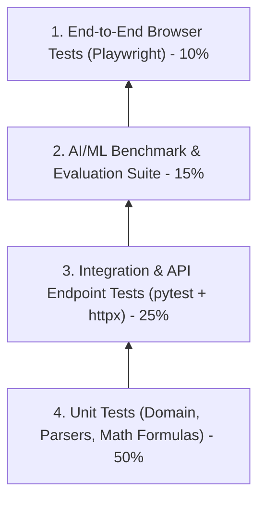

# Testing Strategy & Quality Assurance
## ResumeMatch: Comprehensive Multi-Tier Testing & Evaluation Architecture

---

## 1. Testing Pyramid Overview

To ensure production-grade reliability across both traditional full-stack components and non-deterministic AI/ML heuristics, ResumeMatch implements a **four-tier testing pyramid**:



---

## 2. Unit Testing Strategy (`pytest`)

### 2.1 PDF Extraction Tests (`test_pdf_parser.py`)
- **Valid PDF Extraction**: Asserts accurate text and section segmentation across clean 1-page, 2-page, and 3-page resume samples.
- **Malformed & Corrupted File Guard**: Verifies that non-PDF files (e.g., text files disguised as `.pdf` or truncated binaries) trigger controlled `400 Bad Request` or `422 Unprocessable Entity` errors rather than unhandled server crashes.
- **Page Ceiling Assertion**: Asserts that documents exceeding 10 pages are rejected with an explicit error.
- **Section Heading Heuristics**: Validates that common heading variations ("Professional History", "Work Experience", "Technical Stack") map to canonical sections.

### 2.2 NLP & Entity Extraction Tests (`test_nlp_extractor.py`)
- **Alias Resolution**: Verifies that aliases map to canonical forms (`["postgres", "pgsql"] -> "PostgreSQL"`, `["k8s"] -> "Kubernetes"`).
- **Word-Boundary Isolation**: Rigorous regression testing to ensure single-character and short words do not falsely trigger ("c" inside "cloud", "go" inside "good", "r" inside "react").
- **Experience Timeline Merging**: Verifies that overlapping jobs (e.g., `Jan 2020 - Dec 2021` and `Jun 2021 - Present`) do not double-count overlapping months.
- **Degree Hierarchy Classification**: Asserts correct ranking order across various diploma strings (e.g., `Ph.D.` > `Master of Science` > `B.Tech` > `Associate Degree`).

### 2.3 Scoring Engine Tests (`test_scoring_engine.py`)
- **Mathematical Invariant Assertions**:
  - Scores are strictly bounded: $\forall x, 0 \le \text{Score}(x) \le 100$.
  - Perfect candidate returns $100.0$ ($S_{\text{skills}} = 100, S_{\text{semantic}} = 100, S_{\text{exp}} = 100, S_{\text{edu}} = 100$).
  - Completely mismatched candidate returns near-zero score.
- **Weight Calibration**: Validates that composite scores match the explicit weights:
  $$\text{Composite} = 0.40 \cdot S_{\text{skills}} + 0.35 \cdot S_{\text{sem}} + 0.15 \cdot S_{\text{exp}} + 0.10 \cdot S_{\text{edu}}$$
- **Monotonicity**: Increasing candidate years or matching extra skills strictly increases or maintains the score, never decreases it.

---

## 3. Integration & API Testing (`httpx` + `pytest-asyncio`)

### 3.1 Authentication & Authorization (`test_api_auth.py`)
- **User Registration**: Happy path registration returns 201 and valid JWT.
- **Duplicate Prevention**: Registration with existing email returns 400.
- **Login Validation**: Valid credentials return 200 + token; invalid password returns 401.
- **Token Protection**: Protected routes return 401 when token is missing or expired.

### 3.2 Resume Ingestion & Deletion (`test_api_resumes.py`)
- **Multipart Upload**: Uploads sample PDF binary, verifies 201 response and structured JSON payload.
- **Oversized Upload**: Uploads 6 MB payload, asserts 413 Payload Too Large.
- **Tenant Isolation**: Asserts User A cannot view or delete User B's resume (404/403).
- **Hard Deletion Cascade**: Calling `DELETE /api/v1/resumes/{id}` removes the resume and all matching history atomically from database.

### 3.3 Match Execution (`test_api_match.py`)
- End-to-end execution of `POST /api/v1/match` returning complete explainability breakdown and sub-scores.

---

## 4. AI/ML Benchmark & Evaluation Suite

A critical requirement for an AI engineering portfolio is **automated metric benchmarking** rather than subjective manual testing.

### 4.1 Gold-Standard Ground-Truth Dataset
Stored at `backend/app/evaluation/test_cases.json`, containing 30 hand-curated candidate-to-job scenarios:
- **10 High Fit Cases**: Candidates exceeding or matching all core skills, seniority, and domain context.
- **10 Moderate Fit Cases**: Career-transitioners or candidates missing secondary skills.
- **5 Under-Qualified Cases**: Junior candidates applying for Principal/Lead positions.
- **5 Cross-Domain Rejections**: Unrelated resumes (e.g., Marketing Manager resume matched against Systems Rust Engineer).

### 4.2 Benchmark Runner (`backend/app/evaluation/benchmark.py`)
Executes automated quantitative assertions:
1. **Skill Extraction Precision & Recall**:
   - Asserts $\text{Precision} \ge 0.90$ and $\text{Recall} \ge 0.85$ across ground-truth skill annotations.
2. **Rank Correlation with Human Consensus**:
   - Computes Spearman Rank Correlation ($\rho$) between ResumeMatch composite scores and human ground-truth rankings.
   - Test passes only if $\rho \ge 0.85$.
3. **Latency Benchmarking**:
   - Asserts 95th percentile CPU inference latency $\le 1,500$ ms per match.

---

## 5. End-to-End (E2E) Browser Testing (Playwright)

Playwright runs against the compiled Next.js frontend and live FastAPI backend.

### Test Scenarios:
1. **User Auth Journey**:
   - Navigate to `/register`, create user, redirect to dashboard.
   - Log out, log in via `/login`, verify session persistence.
2. **Resume-to-Job Matching Flow**:
   - Drag and drop sample PDF resume onto the upload zone.
   - Verify upload progress indicator and success badge.
   - Paste job description text into the analysis field.
   - Click "Analyze & Match".
   - Assert match score card renders, radar chart displays, and matched/missing skill badges render.
3. **Safe Deletion Flow**:
   - Click "Delete Resume".
   - Confirm confirmation modal.
   - Assert resume and match history disappear from UI.
4. **Accessibility (a11y) Automated Audit**:
   - Injects `axe-core` on all key views (`/`, `/login`, `/dashboard`, `/match`).
   - Asserts zero critical WCAG 2.1 AA violations.

---

## 6. Continuous Integration (CI) Pipeline Configuration

```yaml
# .github/workflows/backend-ci.yml
name: Backend Quality & Tests

on: [push, pull_request]

jobs:
  test:
    runs-on: ubuntu-latest
    steps:
      - uses: actions/checkout@v4
      - name: Set up Python 3.11
        uses: actions/setup-python@v5
        with:
          python-version: '3.11'
          cache: 'pip'
      - name: Install Dependencies
        run: |
          pip install --upgrade pip
          pip install -r backend/requirements.txt
          pip install -r backend/requirements-dev.txt
      - name: Lint & Type Check
        run: |
          ruff check backend/app
          mypy backend/app
      - name: Run Pytest Suite with Coverage
        run: |
          pytest backend/tests --cov=backend/app --cov-report=term-missing --cov-fail-under=85
      - name: Run AI/ML Benchmark Suite
        run: |
          python backend/app/evaluation/benchmark.py
```
